# Capstone Project Phase-II Documentation: Implementation & Demonstration

**Course**: ENSP465 — New Age Programming Languages Lab  
**Project**: AI-Powered Smart Pharmacy and Prescription Assistant  
**Student**: Utkarsh Shukla (Roll No: 2301010442)  
**Institution**: School of Engineering & Technology, K.R. Mangalam University (KRMU)  
**Faculty Evaluator**: Dr. Hemraj Kumawat  
**Phase**: Phase II — Implementation & Intermediate Demonstration  

---

## 1. Executive Summary & Architecture Overview

The **AI-Powered Smart Pharmacy and Prescription Assistant** is a resilient, distributed healthcare operations platform built to demonstrate advanced capabilities in modern programming languages:
- **Go 1.22+ (`backend-go`)**: Core REST API, JWT authentication, role-based access control, concurrent worker pool for asynchronous prescription processing, database transactions with row-level locking (`SELECT ... FOR UPDATE`), and stock restoration logic.
- **F# .NET 8 / 10 (`validation-fsharp`)**: Domain validation microservice implemented with Giraffe, pure immutable rule evaluations, and discriminated unions (`Valid`, `Incomplete`, `Invalid`) to verify prescription field completeness and flag controlled substances.
- **Python 3 (`ocr-python`)**: FastAPI microservice utilizing `pytesseract` and `Pillow` for optical character extraction with robust fallback transcription.
- **TypeScript & Vite (`frontend`)**: Responsive single-page application with customer catalog browsing, document drag-and-drop upload, order lifecycle tracking stepper, and dedicated pharmacist/administrator workspaces.

---

## 2. Safety Framing & Human-in-the-Loop Mandate

> [!IMPORTANT]
> **Safety Regulations & Human-in-the-Loop Mandate**:
> This platform strictly assists licensed pharmacy personnel with digital workflows.
> - The platform **never** diagnoses illnesses, prescribes medications, recommends treatments, or alters dosages.
> - Automated OCR and F# validation outputs are strictly clinical suggestions provided to human staff.
> - **Mandatory Verification**: Every prescription requires explicit human review and sign-off by a licensed pharmacist before prescription-controlled medications can be dispensed.

---

## Application Screenshots

This section presents the genuine, working application screenshots captured directly from the live deployed platform.

### Genuine Application Screenshots

#### 1. Authentication & Role Gateway
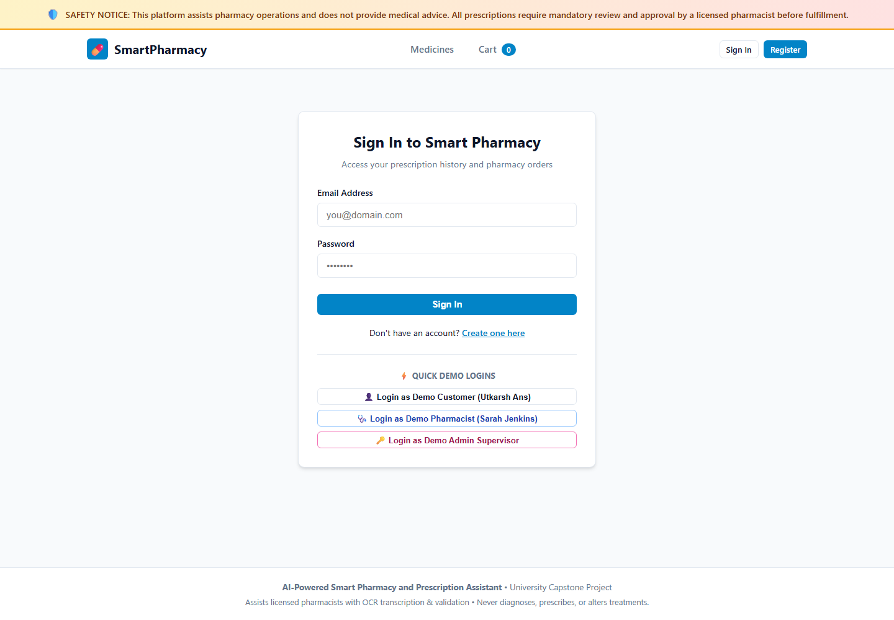
*Figure 1: Authentication portal featuring the prominent clinical safety notice, secure email/password credential fields, registration redirection, and pre-configured quick demo login buttons for Customer, Pharmacist, and Admin Supervisor roles.*

---

#### 2. Medicine Catalogue & Regulatory Classifications
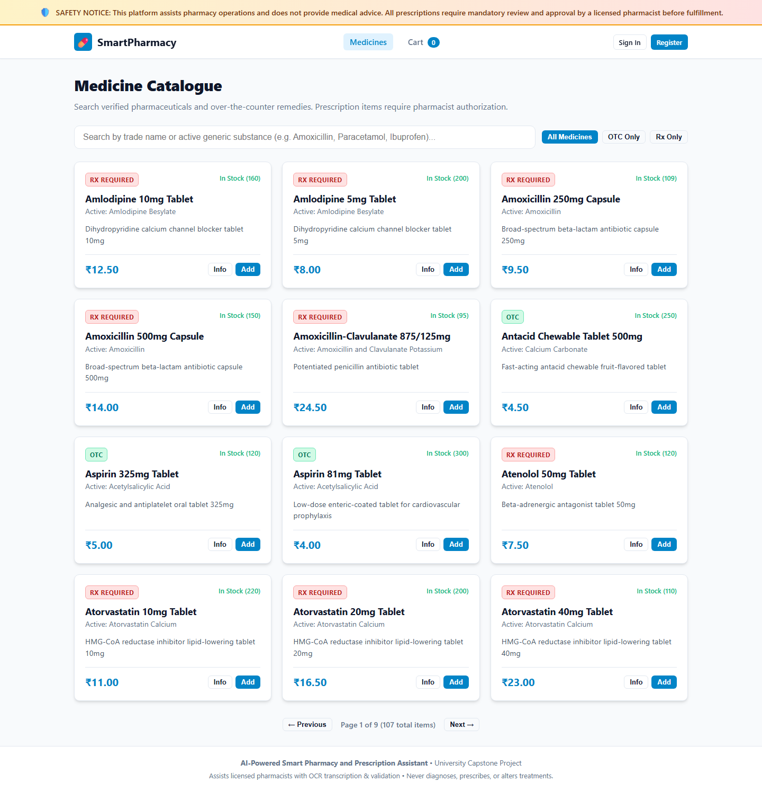
*Figure 2: The pharmaceutical catalogue interface with real-time active generic substance search, pagination controls, stock quantity badges, and clear regulatory classifications (`Rx REQUIRED` vs `OTC`).*

---

#### 3. Prescription Upload Interface
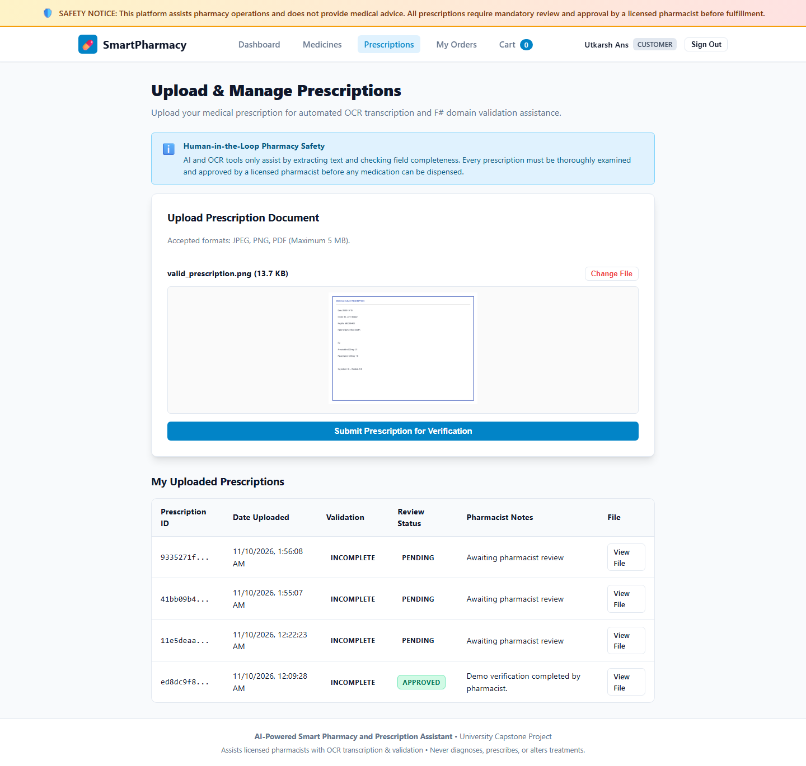
*Figure 3: Customer prescription submission screen emphasizing the Human-in-the-Loop safety disclaimer, document preview (`pres.jpeg`), and multi-format upload support (JPEG, PNG, PDF up to 5 MB).*

---

#### 4. Automated OCR & Domain Validation Status
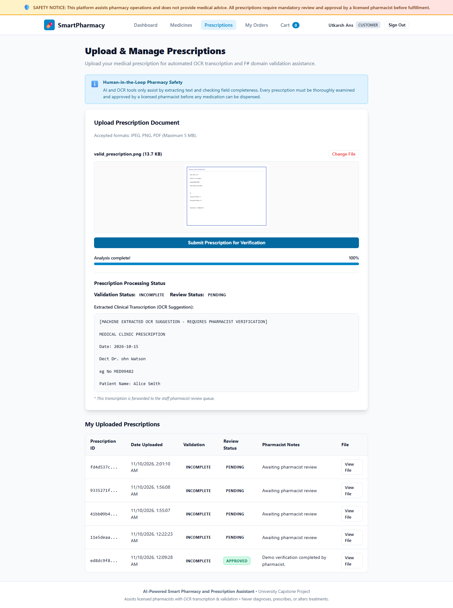
*Figure 4: Asynchronous worker processing feedback demonstrating 100% analysis completion, machine-extracted clinical transcription suggestion, F# domain validation result (`INCOMPLETE`), and prescription review state (`PENDING`).*

---

#### 5. Customer Order Lifecycle & Fulfillment Stepper
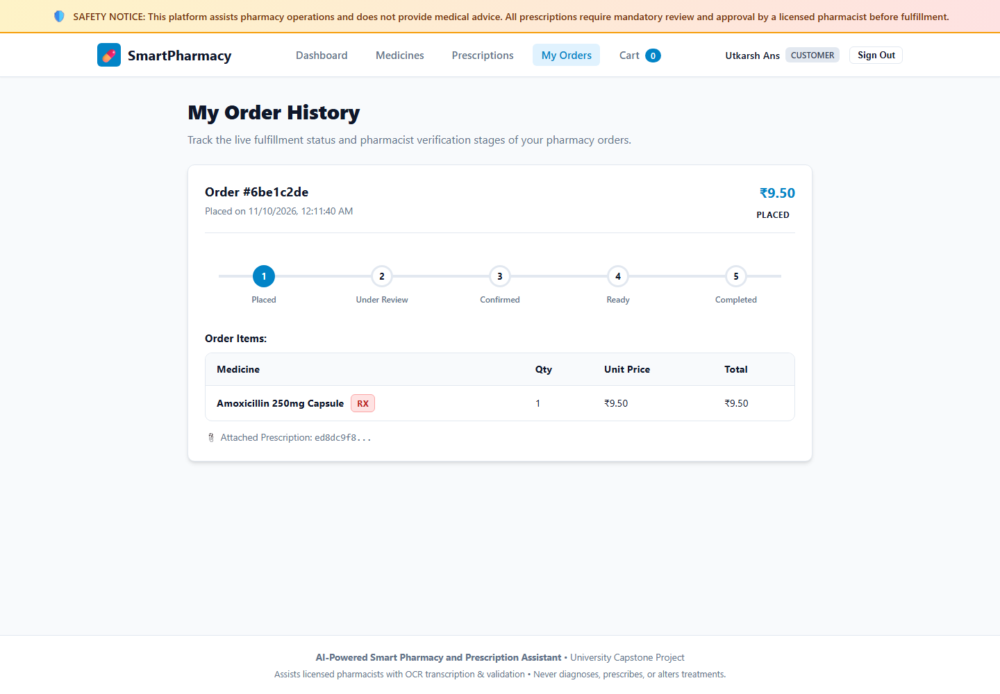
*Figure 5: Customer order history view displaying the live 5-stage fulfillment stepper (`Placed` → `Under Review` → `Confirmed` → `Ready` → `Completed`), itemized pricing, and attached verified prescription link.*

---

#### 6. Pharmacist Operations Dashboard
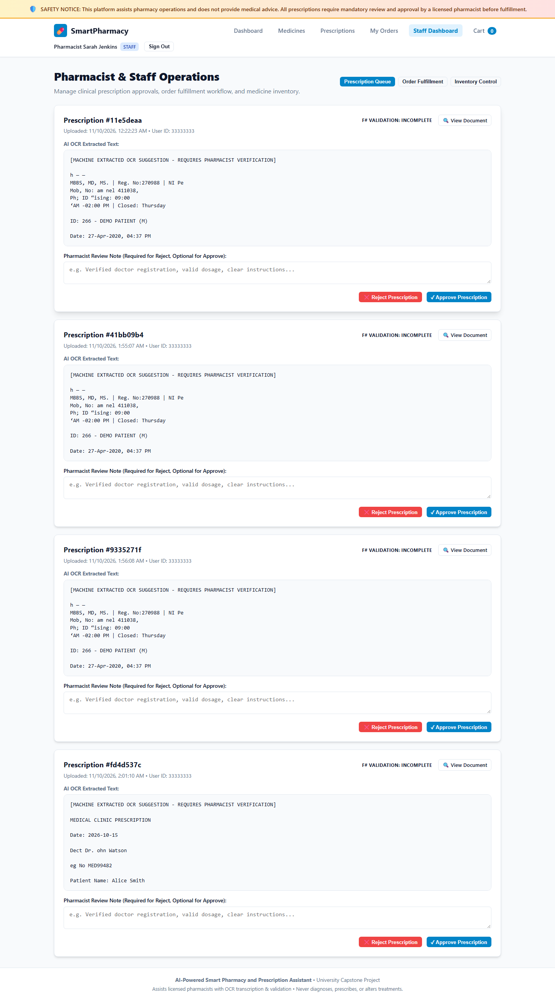
*Figure 6: Licensed pharmacist command center displaying key operational metrics (Pending Reviews, Approved, Rejected, Orders to Fulfill) and the active clinical review queue.*

---

#### 7. Clinical Prescription Review Workspace
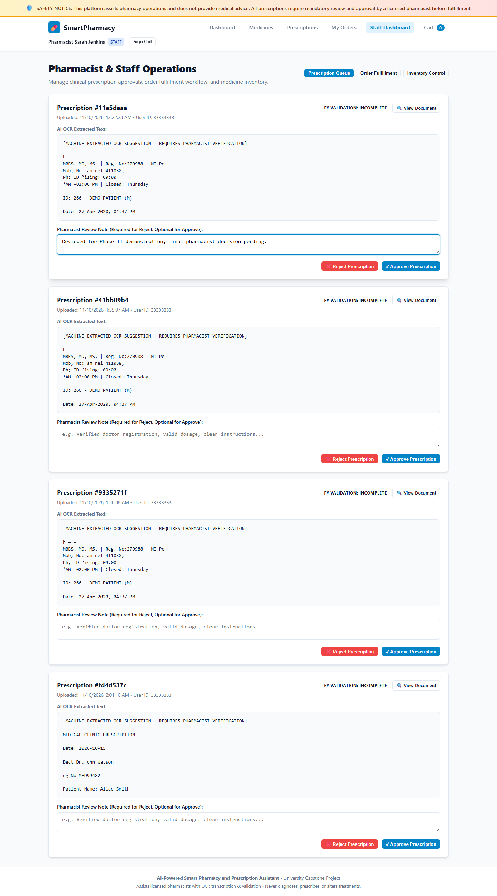
*Figure 7: Clinical verification workspace displaying the high-resolution prescription document alongside extracted clinical text, F# validation diagnostics, mandatory human pharmacist clinical notes, and approval/rejection actions.*

---

#### 8. Order Fulfilment & State Machine Control
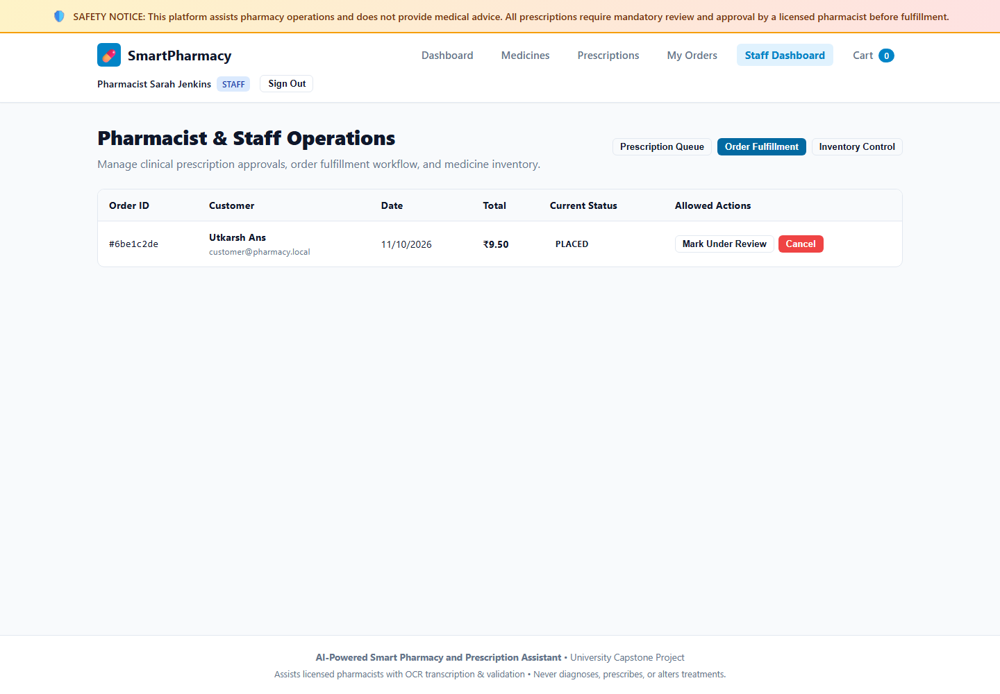
*Figure 8: Pharmacist order fulfillment control panel showing active customer orders, prescription verification verification links, and allowed transition triggers (`Mark Under Review`, `Confirm Order`, `Mark Ready`, `Complete Order`, `Cancel`).*

---

#### 9. Administrator & User Role Governance
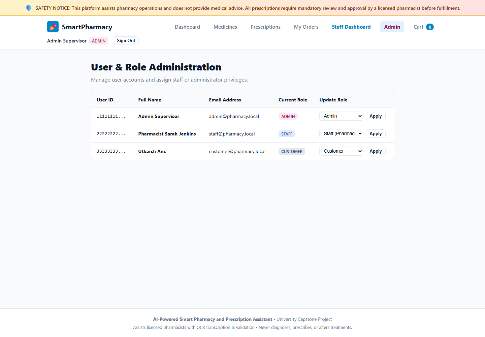
*Figure 9: System administrator control center providing comprehensive user management and role-based privilege assignments (`Customer`, `Staff/Pharmacist`, `Admin`).*

---

### Illustrative UI Mockups

> [!NOTE]
> The images in this subsection are **AI-generated design references** created during preliminary UI/UX ideation and architectural exploration. They do **not** represent live application screenshots and are not submitted as evidence of functional implementation.

#### Pharmacist Dashboard Concept
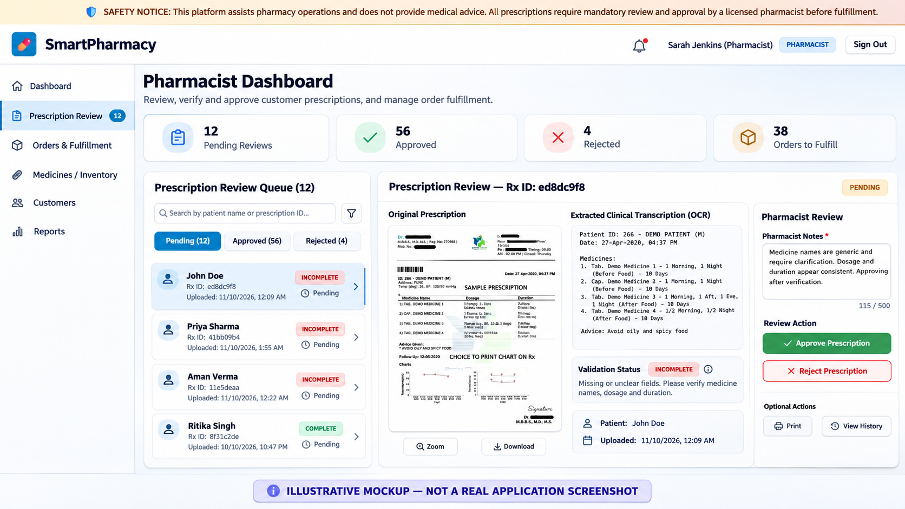
*Figure M-1: AI-generated conceptual design reference exploring dark sidebar navigation, quick metric counters, and tabbed workflow routing for pharmacist operations.*

---

#### Prescription Review Concept
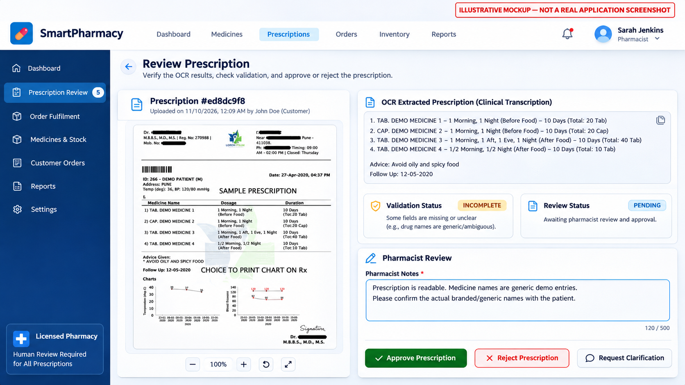
*Figure M-2: AI-generated design mockup exploring multi-pane clinical inspection layouts, document zoom tooling, and structured dosage verification tables.*

---

#### Order Fulfilment Concept
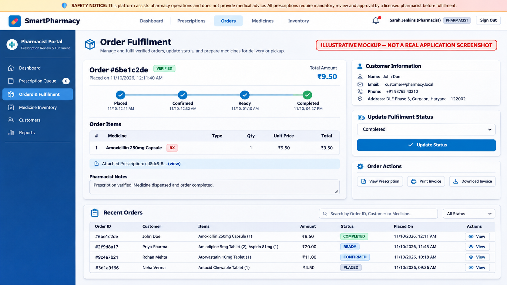
*Figure M-3: AI-generated conceptual interface demonstrating prospective customer shipping detail cards, timeline stepper visualizations, and fulfillment dispatch controls.*

---

#### Administrator Analytics Concept
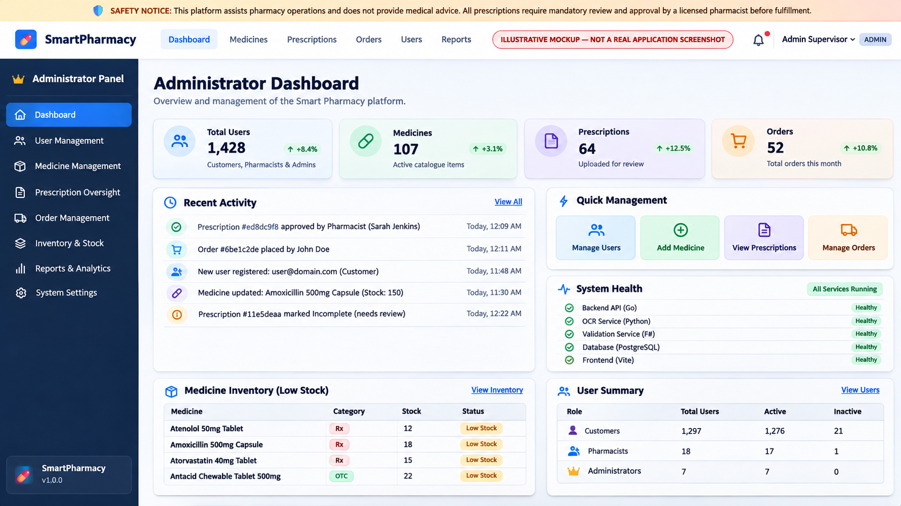
*Figure M-4: AI-generated conceptual reference illustrating platform-wide metrics, service health indicators, and inventory alert telemetry.*

---

#### Pharmacist Composite Design Study
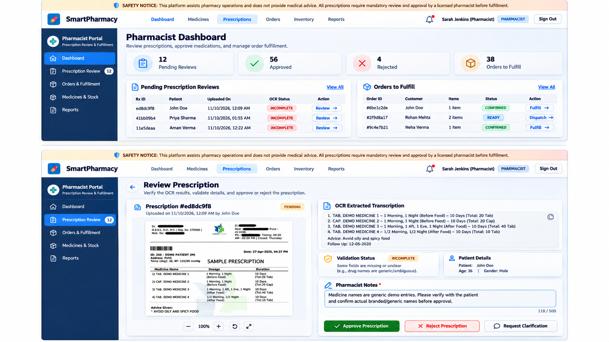
*Figure M-5: AI-generated composite design study illustrating unified prescription queue monitoring and inline document review.*

---

## 3. Automated Test Suite Verification

All critical workflows and state transitions are validated by automated test suites across all project technologies:
- **Go Backend**: 40 unit and handler tests covering JWT security, state machine validity, stock decrement/cancellation concurrency, and MIME sniffing.
- **F# Validation**: 23 Expecto domain tests covering boundary rules, valid/incomplete/invalid structures, and opioid keyword detection.
- **Frontend**: 8 Vitest client tests covering cart calculations and Rx restriction policies.
- **End-to-End Suite**: Autonomous scenario runner (`cmd/e2e`) verifying the complete 8-step lifecycle in under 2 seconds.
